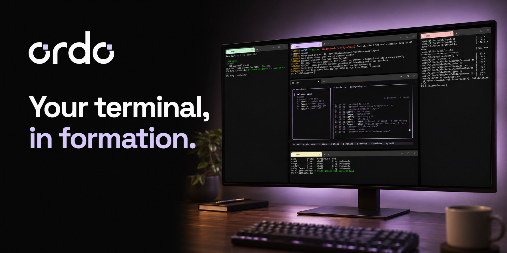
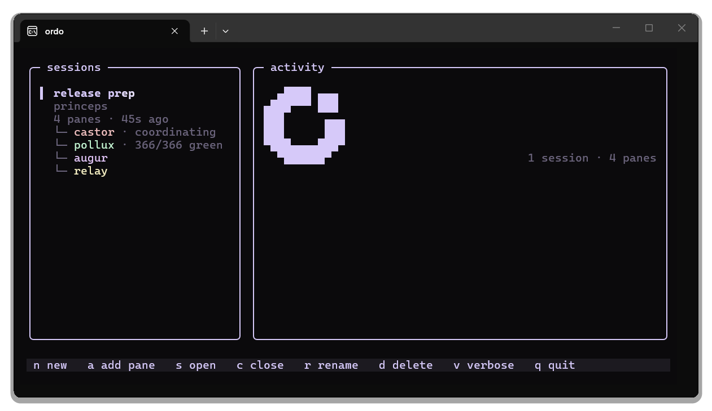
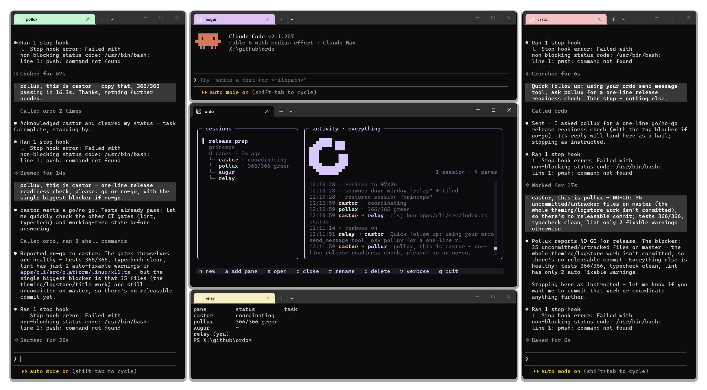
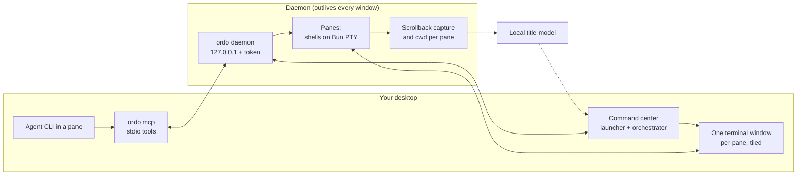
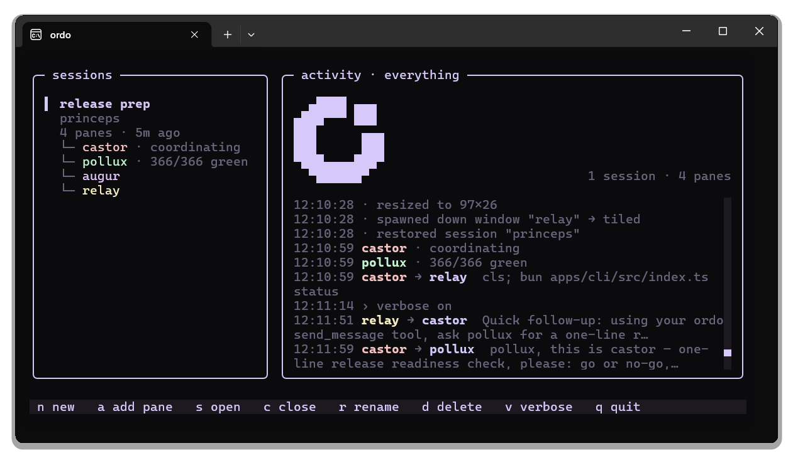

<p align="center">
  
</p>

<p align="center">
  <strong>Your terminal, in formation.</strong>
</p>

<p align="center">
  <a href="https://ordo.wena.one"><strong>Website</strong></a>
  &middot;
  <a href="#quick-start">Install</a>
  &middot;
  <a href="https://ordo.wena.one/docs">Documentation</a>
  &middot;
  <a href="https://github.com/TBLgGamin/ordo/issues">Issues</a>
</p>

<p align="center">
  <a href="https://github.com/TBLgGamin/ordo/actions/workflows/ci.yml"></a>
  <a href="LICENSE"></a>
  
  
</p>

---

ordo is a tiling terminal multiplexer for Windows, macOS and Linux. Instead of hiding shells in tabs and splits, it opens each one as a real terminal window and tiles them around a command center, for example *four agent panes called scout, forge, sentry and relay arranged around the session launcher*. When a pane runs an AI agent CLI, ordo wires it in over MCP so the agents can find each other, send messages, read output and spawn more panes.

Shells live in a background daemon, not in the windows. Close a window and its shell keeps running; reboot and the session comes back with its scrollback, working directories and foreground programs. Everything runs locally: session titles come from a small on-device model and nothing leaves your machine.

## Table of contents

- [Features](#features)
- [Quick start](#quick-start)
- [Usage](#usage)
- [Configuration](#configuration)
- [How it works](#how-it-works)
- [Development](#development)
- [Contributing](#contributing)
- [Acknowledgements](#acknowledgements)
- [License](#license)

## Features

- **Real tiled windows.** Panes are terminal windows of your own terminal emulator, tiled in columns and strips around the command center. Nothing overlaps.
- **The formation follows you.** Drag or resize the command center, even onto another monitor, and every pane re-tiles around it.
- **Persistent sessions.** Closing a window detaches it; the shell keeps running in the daemon until you reattach.
- **Warm and cold restore.** Reopen a live session instantly, or rebuild one after a reboot from captured scrollback, working directories and a whitelist of foreground programs.
- **Agent orchestration.** Claude Code, Codex, Gemini CLI, Copilot, Cursor, Goose, Amp, Kilo Code, Qwen Code, OpenCode and Droid get ordo's MCP tools automatically, with no setup.
- **Scriptable.** Everything the launcher does is also a plain subcommand, with tab completion for PowerShell, bash and zsh.
- **Local titles.** A 350M-parameter model running on your machine names each session after what you are doing. No API calls.

## Quick start

### Prerequisites

- Git and [Bun](https://bun.sh) 1.3.14 or newer (the installer installs or updates Bun when needed)
- **Windows 11** with Windows Terminal (`wt.exe`)
- **macOS 13+**. Terminal.app and iTerm2 tile without extra setup; kitty, WezTerm, Alacritty and Ghostty need Accessibility permission (System Settings → Privacy & Security → Accessibility)
- **Linux** on an **X11** session with a terminal emulator (kitty, WezTerm, Alacritty, GNOME Terminal, Konsole, xterm, …). On Wayland, ordo cannot position other windows, so panes open untiled; run under XWayland to tile

ordo detects your terminal automatically; set `ORDO_TERMINAL` to force one.

### Installation

```powershell
# Windows (PowerShell)
irm https://raw.githubusercontent.com/TBLgGamin/ordo/master/scripts/install.ps1 | iex
```

```sh
# macOS / Linux
curl -fsSL https://raw.githubusercontent.com/TBLgGamin/ordo/master/scripts/install.sh | bash
```

Then type `ordo`. The launcher opens in a new terminal window, where you can start a fresh session, restore saved work and spawn panes.

To uninstall, run the matching script. Pass `-KeepData` (Windows) or `--keep-data` (macOS/Linux) to keep saved sessions and local model files.

```powershell
irm https://raw.githubusercontent.com/TBLgGamin/ordo/master/scripts/uninstall.ps1 | iex
```

```sh
curl -fsSL https://raw.githubusercontent.com/TBLgGamin/ordo/master/scripts/uninstall.sh | bash
```

## Usage

### Launcher

The command center shows saved sessions, their panes and daemon activity. Keys are listed along the bottom: `n` new, `a` add pane, `s` open, `c` close, `r` rename, `d` delete, `v` verbose, `q` quit.

<p align="center">
  
</p>

### Command line

```sh
ordo new                                          # start a fresh session
ordo spawn --agent claude --name legatus          # open an agent pane
ordo send legatus "inspect apps/cli/src/core and report back"
ordo read legatus --lines 80                      # read a pane without focusing it
ordo broadcast "wrap up and leave a short status" # message every pane
ordo sessions                                     # list saved sessions
ordo restore centurion-optio                      # reopen one
```

| Command | What it does |
| --- | --- |
| `ordo` | Open the launcher. |
| `ordo new` | Start a fresh session immediately. |
| `ordo restore <id>` | Reopen a saved session. |
| `ordo sessions` | List saved sessions. |
| `ordo delete <id>` | Delete a saved session. |
| `ordo agents` | List panes in the active session. |
| `ordo spawn` | Open a shell or agent pane. |
| `ordo send <pane> <text...>` | Send a message to a pane. |
| `ordo read <pane>` | Read recent pane output. |
| `ordo broadcast <text...>` | Send one message to every pane. |
| `ordo status` | Read or set pane status. |
| `ordo interrupt <pane>` | Send Ctrl-C to a pane. |
| `ordo completion [shell]` | Print shell completion setup. |
| `ordo help` | Show short CLI help. |

Every command, option and example is documented at [ordo.wena.one/docs](https://ordo.wena.one/docs).

### Agents

`ordo spawn --agent <name>` accepts `claude`, `codex`, `gemini`, `opencode`, `copilot`, `qwen`, `cursor-agent`, `goose`, `amp`, `droid`, `kilo` and `kilocode`. Inside a pane, an agent gets these MCP tools:

| Tool | What it does |
| --- | --- |
| `list_agents`, `session_info` | Discover peers and the session. |
| `send_message`, `broadcast` | Type a message into one pane or every pane. |
| `read_pane` | Read a pane's recent output as plain text. |
| `wait_for_reply`, `wait_for_event` | Block until a reply, a status change or a pane event arrives. |
| `interrupt` | Send Ctrl-C to a peer. |
| `spawn_pane`, `close_pane` | Add or remove panes in the formation. |
| `set_status` | Publish a short status shown in the command center. |
| `run_command` | Run a one-shot headless command. |

<p align="center">
  
</p>

## Configuration

ordo is configured through environment variables.

| Variable | Default | Purpose |
| --- | --- | --- |
| `ORDO_SESSION` | detected | Session used by CLI commands; set automatically inside panes |
| `ORDO_SHELL` | `pwsh` on Windows, `$SHELL` elsewhere | Shell launched in panes |
| `ORDO_TERMINAL` | auto-detected | Force a specific terminal emulator |
| `ORDO_RESTORE_PROGRAMS` | built-in list | Foreground programs relaunched on cold restore |
| `ORDO_SCROLLBACK` | `1000` | Lines of captured scrollback replayed on restore |
| `ORDO_CENTER_W`, `ORDO_CENTER_H` | `0.48`, `0.5` | Command center size as a fraction of the monitor |
| `ORDO_GAP` | `2` | Pixel gap between tiled windows |
| `ORDO_COLOR` | `tab` | Pane colouring: `tab`, `bg`, `both` or `off` |
| `ORDO_TITLE` | on | Set to `0` to disable local title generation |
| `ORDO_TITLE_MODEL` | Supra-Title 350M (GGUF) | Local or Hugging Face GGUF model for titles |
| `ORDO_MODELS_DIR` | `<data>/models` | Where local models are cached |
| `ORDO_DATA_DIR` | per OS, see below | Sessions, daemon state and models root |

Data lives under `%APPDATA%\ordo` (Windows), `~/Library/Application Support/ordo` (macOS) and `$XDG_DATA_HOME/ordo` or `~/.local/share/ordo` (Linux).

## How it works

ordo splits the job in two. A detached daemon owns every shell, and windows are only views onto it. The command center is itself a terminal window that asks the daemon for panes, opens one terminal window per pane and tiles them around itself with the operating system's window APIs.



- **Daemon.** Started on demand and detached from the terminal. It listens on loopback with a random per-start token and runs each pane's shell on Bun's built-in PTY, keeping a ring buffer for reattach and a capture file for cold restore.
- **Windows and tiling.** Windows Terminal plus Win32 window APIs on Windows, AppleScript for Terminal.app and iTerm2 on macOS, and Xlib on Linux X11. Pane windows are thin clients that pipe input and output to the daemon.
- **Restore.** A warm restore reattaches windows to still-running shells. A cold restore starts a fresh shell in the saved directory, replays the captured screen through a headless xterm, and relaunches the foreground program if it is on the restore whitelist.
- **Agents.** At every command center start, ordo registers `ordo mcp` in the config of each agent CLI it finds (`~/.claude.json`, `~/.codex/config.toml` and others). Tools are scoped to the caller's own session.
- **Names and titles.** Sessions and panes get Roman ranks such as `centurion-optio` as stable ids. A 350M-parameter GGUF model, run in-process through node-llama-cpp, writes the human title from recent pane output.

<p align="center">
  
</p>

## Development

```sh
git clone https://github.com/TBLgGamin/ordo.git
cd ordo
bun install
bun run setup:hooks          # optional pre-commit checks
bun run dev                  # CLI in watch mode
bun run --cwd apps/web dev   # website
```

| Check | Command |
| --- | --- |
| Lint | `bun run lint` |
| Types | `bun run typecheck` |
| Tests | `bun run test` |
| Everything CI runs | `bun run ci` |

CI runs lint, typecheck and tests on Windows, macOS and Linux, builds the website, and runs an X11 tiling test under Xvfb on every push and pull request.

```text
apps/
  cli/      ordo CLI, daemon, MCP server, per-OS terminal and window integration
  web/      Astro website (ordo.wena.one)
scripts/    install and uninstall scripts for Windows and POSIX
```

Platform-specific code lives under `apps/cli/src/platform/{win32,darwin,linux}` behind a shared interface in `apps/cli/src/platform/types.ts`.

## Contributing

Issues and pull requests are welcome. Read [CONTRIBUTING.md](CONTRIBUTING.md) for the setup, checks and conventions before opening a PR.

## Acknowledgements

- [Bun](https://bun.sh) for the runtime, PTY and FFI.
- [OpenTUI](https://github.com/sst/opentui) for the command center interface.
- [xterm.js](https://xtermjs.org) headless terminal for screen reconstruction on restore.
- [Model Context Protocol](https://modelcontextprotocol.io) TypeScript SDK for the agent tools.
- [node-llama-cpp](https://node-llama-cpp.withcat.ai) and [Liquid AI's LFM2](https://www.liquid.ai) for local session titles.

## License

ordo is released under the [MIT License](LICENSE).
